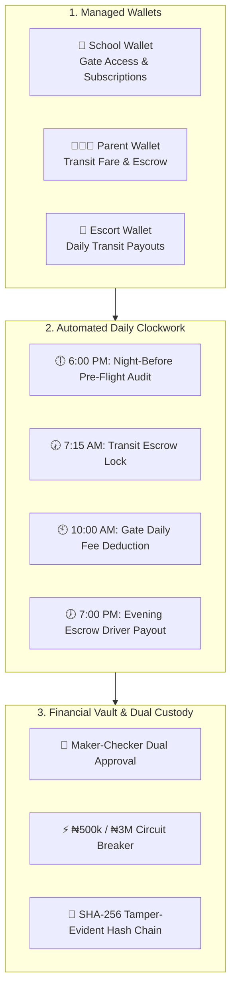
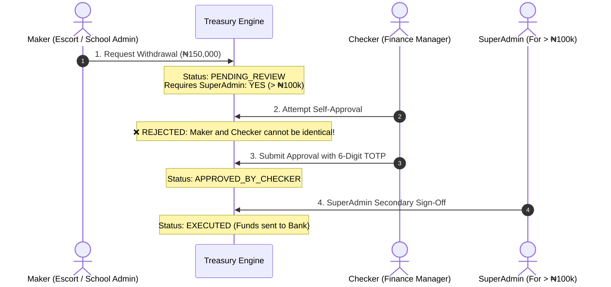

# 🛡️ MyEduRide Wallet System — Executive & Management Manual Testing Guide
**Version:** 2.0 (Post-Phase 7 Release)  
**Audience:** C-Suite, Product Managers, Operations Directors, Finance & Compliance Audit Team  
**System Classification:** Production-Grade Fintech Transit Vault & Escrow Engine  

---

## 📌 Executive Summary

The **MyEduRide Wallet System** is a zero-loss, closed-loop financial infrastructure designed specifically for school campus security and safe transit. It governs three distinct wallet types, automated daily batch settlements, dual-channel cryptographic receipts, maker-checker dual custody, and tamper-evident cryptographic ledger chains.

This guide provides step-by-step, non-technical instructions for management and operations teams to manually test and verify every financial journey in the application.



---

## 🔑 Test Roles & Quick Switcher

MyEduRide includes a built-in **Role Switcher** on all dashboard headers (top right) so management can switch between personas in one click without logging out:

| Persona | Switcher Role | Primary Testing Dashboard |
|---|---|---|
| **School Administrator** | `school_admin` | `/dashboard/school-admin/wallet` |
| **Parent / Guardian** | `parent` | `/dashboard/parent?tab=wallet` |
| **MyEduRide Escort** | `escort` | `/dashboard/myeduride-escort` (Click "Wallet") |
| **Super Admin / Treasury** | `super_admin` | `/dashboard/super-admin` |

---

## 🧪 Test Module 1: School Wallet & Daily Gate Platform Deductions

### 🎯 Objective
Verify that a school can monitor balances, fund its wallet via the payment gateway, generate official digital receipts, and execute daily gate platform fee deductions.

### Step-by-Step Instructions:

#### 1.1 Access School Wallet
1. Open your browser and navigate to: `http://localhost:3000/dashboard/school-admin/wallet` (or production URL).
2. Ensure your top navigation indicates you are signed in as **School Administrator**.
3. **Verify Display Elements**:
   - **Available Balance**: Displayed in Nigerian Naira (`₦`).
   - **Dedicated Virtual NUBAN Account**: Moniepoint / Wema / Providus virtual account number with a one-click **Copy** button.
   - **Three-Pillar Balance Breakdown**: Available, Reserved (for gate fees), and Escrow balances.
   - **Quick Actions**: "Fund Wallet", "Withdraw", "Transfer", and "Statement".

#### 1.2 Fund School Wallet via Payment Gateway
1. Click the **"Fund Wallet"** button (or the `+` icon on mobile).
2. In the modal, select a preset amount (e.g., `₦50,000`) or enter a custom amount.
3. Select payment method: **Card / Bank Transfer (SeerBit)**.
4. Click **"Proceed to Secure Payment"**.
5. *In Demo/Sandbox Mode*: The payment gateway will simulate success and redirect back to your wallet.
6. **Expected Result**:
   - A success toast appears: `School wallet credited successfully! 🏫💳`.
   - The available balance increments instantly by the exact deposit amount.
   - A new row appears at the top of the **Transaction History** table with type `CREDIT` and channel `SEERBIT_CHECKOUT`.

#### 1.3 View & Print Cryptographic Digital Receipt
1. In the **Transaction History** table, locate the deposit you just made.
2. Click the **"Receipt"** button (or printer icon) on that row.
3. **Inspect the Digital Receipt Modal**:
   - **Receipt Number**: Follows official format `REC-YYYYMMDD-XXXX`.
   - **VAT Breakdown**: Subtotal + 7.5% Nigerian VAT + Total paid.
   - **Status Badge**: Green badge marked `OFFICIAL RECEIPT` / `VERIFIED`.
   - **Cryptographic Hash**: SHA-256 HMAC signature at the bottom confirming bank non-repudiation.
4. Click **"Print Receipt"**: Ensure the browser print preview opens with clean formatting (headers, watermarks, zero UI clutter).

#### 1.4 Test Gate Platform Fee Auto-Deduction
1. Note the current **Available Balance**.
2. Open a separate browser tab and trigger the daily gate deduction endpoint:
   ```bash
   # Terminal or browser:
   curl -X POST http://localhost:3000/api/cron/daily-gate-digest
   ```
3. Return to the School Wallet tab and click the **Refresh** icon.
4. **Expected Result**:
   - Balance decreases by the school's configured daily gate fee (e.g., `₦500.00`).
   - Transaction list shows a new `DEBIT` item with description `Daily Gate Management & Platform Security Fee`.

---

## 🧪 Test Module 2: Parent Wallet, Receipts & Transit Escrow

### 🎯 Objective
Verify that parents can fund their transit wallet, receive real-time balance credibility validation, and experience automatic escrow lockups when rides are dispatched.

### Step-by-Step Instructions:

#### 2.1 Access Parent Wallet
1. Switch role to **Parent** via the top-right switcher.
2. Navigate to: `http://localhost:3000/dashboard/parent?tab=wallet`.
3. **Verify Display Elements**:
   - Large Green/Emerald Balance Card showing **Available Balance**.
   - **Active Escrow Holds** counter (reflects rides currently in transit).
   - Monthly transit spend analytics bar.
   - Transaction Ledger with credit/debit indicators.

#### 2.2 Top Up Parent Transit Balance
1. Click the **"Fund Wallet"** button on the balance card.
2. Select a quick funding chip: **₦10,000**.
3. Click **"Pay with Card / Bank Transfer"**.
4. Confirm payment in the gateway modal.
5. **Expected Result**:
   - Available balance updates immediately.
   - A toast confirms: `Payment successful! Your wallet has been credited.`
   - Click the receipt icon on the new transaction to view the parent invoice.

#### 2.3 Test the 6:00 PM Night-Before Pre-Flight Balance Audit
This automated engine runs daily at 6:00 PM Lagos time to audit whether parents have enough funds for tomorrow morning's school run.

1. **Test Scenario A: Sufficient Balance (Credibility Pass)**
   - Parent has ₦10,000 in balance, and tomorrow's 2-child fare is ₦3,000.
   - Trigger the audit endpoint manually:
     ```bash
     curl -X GET http://localhost:3000/api/cron/pre-flight-balance-audit
     ```
   - **Expected Result**: Parent receives an email / in-app notification:
     > *"✅ Transit Credibility Confirmed: Your wallet balance is sufficient for tomorrow's school run."*

2. **Test Scenario B: Low Balance (Instant Top-Up Shortfall Alert)**
   - When a parent's balance is below tomorrow's required fare:
   - **Expected Result**: The engine sends a high-priority warning with the exact calculated deficit:
     > *"⚠️ Your balance is ₦500, which is below tomorrow's required fare of ₦3,000. Please top up ₦2,500 tonight to avoid morning pickup disruption."*
     > Button: **[Top Up ₦2,500 Now]** (direct link with pre-filled amount).

#### 2.4 Verify Morning Escrow Hold Lock (07:15 AM Cutoff)
1. When a morning pickup is locked at 07:15 AM:
2. The fare (e.g., `₦1,500`) moves from **Available Balance** to **Active Escrow**.
3. Available balance decreases, but total account funds remain preserved in protected escrow.

---

## 🧪 Test Module 3: Escort Wallet & 7:00 PM Evening Batch Settlement

### 🎯 Objective
Verify that transport fees locked in escrow are automatically settled into the driver/escort wallet every evening at 7:00 PM upon safe completion of all scheduled trips.

### Step-by-Step Instructions:

#### 3.1 Check Escort Balance Pre-Settlement
1. Switch role to **MyEduRide Escort**.
2. Navigate to: `http://localhost:3000/dashboard/myeduride-escort`.
3. Click on the **"Wallet"** tab in the bottom bar or left sidebar.
4. Note the current **Available Earnings Balance** (e.g., `₦12,500.00`).

#### 3.2 Trigger the 7:00 PM Automated Escrow Settlement
1. Simulate the 7:00 PM evening cron job by calling the endpoint:
   ```bash
   curl -X GET http://localhost:3000/api/cron/evening-escrow-settlement
   ```
2. Inspect the JSON response:
   ```json
   {
     "success": true,
     "processedTrips": 4,
     "totalPayoutNgn": 6000,
     "timestamp": "2026-10-17T19:00:00Z"
   }
   ```

#### 3.3 Verify Escort Wallet Credit
1. Refresh the Escort Wallet page.
2. **Expected Result**:
   - Escort balance increases by the exact completed fare total.
   - A credit transaction appears: `Evening Escrow Settlement - Batch Release`.
   - The Parent's escrow hold for that trip transitions from `HELD_IN_ESCROW` to `SETTLED`.

---

## 🧪 Test Module 4: Treasury Maker-Checker Dual Custody for Withdrawals

### 🎯 Objective
Verify that no single user—including high-level executives—can unilaterally transfer money out of the system without independent dual-authorization and TOTP token verification.

### Step-by-Step Instructions:



#### 4.1 Initiate Withdrawal Request (Maker Action)
1. Sign in as an **Escort** or **School Admin**.
2. In your Wallet, click **"Withdraw to Bank"**.
3. Select your linked NUBAN bank account and enter an amount (e.g., `₦25,000`).
4. Click **"Submit Withdrawal Request"**.
5. **Expected Result**: Toast shows: `Withdrawal request submitted for Treasury review.` Status is `PENDING_REVIEW`.

#### 4.2 Test Anti-Fraud Self-Approval Invariant
1. Attempt to approve your own withdrawal with the same account ID:
2. **Expected Result**: System immediately halts the transaction with error:
   > `[DUAL_CUSTODY_VIOLATION] Maker and Checker cannot be the same user.`

#### 4.3 Approve as Independent Checker (Checker Action)
1. Switch to a designated **Finance Officer / Checker** account.
2. Navigate to Treasury Withdrawals API / Portal:
   ```bash
   curl -X POST http://localhost:3000/api/treasury/withdrawals \
     -H "Content-Type: application/json" \
     -d '{
       "action": "checker_approve",
       "requestId": "<REQUEST_UUID>",
       "checkerUserId": "<CHECKER_USER_ID>",
       "totpToken": "123456"
     }'
   ```
3. **Expected Result**:
   - For standard amounts ($\le$ ₦100k for escorts, $\le$ ₦500k for schools): The request advances to `EXECUTED` and funds are disbursed.
   - For high-value amounts: Status transitions to `APPROVED_BY_CHECKER` and flags `requires_super_admin: true`.

#### 4.4 High-Value SuperAdmin Secondary Escalation
1. For withdrawals over ₦100,000 (escorts) or ₦500,000 (schools):
2. Switch to **Super Admin**.
3. Call the SuperAdmin execution endpoint:
   ```bash
   curl -X POST http://localhost:3000/api/treasury/withdrawals \
     -H "Content-Type: application/json" \
     -d '{
       "action": "superadmin_approve",
       "requestId": "<REQUEST_UUID>",
       "superAdminUserId": "<SUPERADMIN_USER_ID>",
       "totpToken": "123456"
     }'
   ```
4. **Expected Result**: Status updates to `EXECUTED` with audit trail recording both Maker, Checker, and SuperAdmin timestamps.

---

## 🧪 Test Module 5: Financial Vault Hardening & Velocity Limits

### 🎯 Objective
Confirm that malicious attempts to tamper with database balances or initiate abnormally large payouts are blocked in real-time by the Financial Circuit Breaker.

### Step-by-Step Instructions:

#### 5.1 Test Deposit Velocity Ceiling (₦500,000 Single Deposit Limit)
1. Attempt to fund a parent wallet with `₦600,000.00` in a single transaction.
2. **Expected Result**:
   - The transaction is blocked before reaching the payment gateway.
   - Error returned: `[CIRCUIT_BREAKER_DEPOSIT_EXCEEDED] Single parent deposit cannot exceed ₦500,000.00.`

#### 5.2 Test Platform Hourly Outflow Ceiling (₦3,000,000 Cap)
1. When aggregate bank payouts within any rolling 60-minute window exceed ₦3,000,000:
2. **Expected Result**:
   - The circuit breaker automatically trips to `TRIPPED` state.
   - Outbound payouts are frozen instantly.
   - SuperAdmin receives an alert: `Treasury velocity limit exceeded. Payouts paused.`

#### 5.3 Verify Cryptographic Hash-Chain Ledger Integrity (`verify_ledger_chain`)
Every transaction row is cryptographically chained to its predecessor using SHA-256. If any database administrator or attacker manually alters a balance or row in SQL, the chain breaks immediately.

1. Run the database ledger audit:
   ```bash
   curl -X POST http://localhost:3000/api/treasury/withdrawals \
     -H "Content-Type: application/json" \
     -d '{
       "action": "audit_ledger",
       "walletId": "<WALLET_UUID>"
     }'
   ```
2. **Expected Result**:
   - Returns: `{"intact": true, "message": "Ledger hash chain intact and mathematically verified across all rows."}`
   - Any manual database tampering will cause the chain check to fail: `{"intact": false, "brokenRowId": "...", "action": "HALT_PAYOUTS"}`.

---

## 📋 Management Acceptance Sign-Off Matrix

Use the checklist below to document test completion during management review:

| # | Test Scenario | Expected Outcome | Pass/Fail | Tester Initials | Date Tested |
|---|---|---|:---:|:---:|:---:|
| **1** | School Wallet Overview | Balance, NUBAN, and 3-pillar breakdown render accurately | [ ] | | |
| **2** | School Deposit via SeerBit | Balance credits instantly with toast notification | [ ] | | |
| **3** | Digital Receipt Generation | `REC-` code, VAT math, HMAC, and print preview render | [ ] | | |
| **4** | Daily Gate Fee Deduction | `₦500.00` auto-debited with clear ledger description | [ ] | | |
| **5** | Parent Deposit & Balance | Parent balance increments and transaction log updates | [ ] | | |
| **6** | 6:00 PM Pre-Flight Audit | Credibility pass / Low-balance top-up alerts generated | [ ] | | |
| **7** | Transit Escrow Lock (07:15 AM) | Available balance decreases; escrow hold active | [ ] | | |
| **8** | 7:00 PM Evening Settlement | Escort receives ride payout; escrow marked SETTLED | [ ] | | |
| **9** | Maker-Checker Withdrawal | Self-approval blocked; independent checker approved | [ ] | | |
| **10**| High-Value Escalation | > ₦100k escort / > ₦500k school requires SuperAdmin | [ ] | | |
| **11**| Circuit Breaker Limits | ₦500k deposit cap & ₦3M hourly payout velocity halt | [ ] | | |
| **12**| Cryptographic Hash Chain | `verify_ledger_chain()` reports 100% intact chain | [ ] | | |

---

## ❓ Frequently Asked Questions & Troubleshooting

### Q1: What should I do if a test payment shows "Pending" instead of "Success"?
> In sandbox environments, internet drops or gateway webhook delays can keep a transaction in `PENDING`. Simply click the **"Refresh"** button on the wallet header or re-verify via the payment reference in the URL.

### Q2: Can a School Administrator withdraw all their money to zero?
> No. The system maintains a protected **Reserved Balance** earmarked for upcoming gate security deductions. The UI clearly distinguishes between **Total Balance** and **Available for Withdrawal**.

### Q3: How do we know money is never lost during daily transits?
> The system enforces the **Fintech Zero-Loss Invariant**:
> $$\text{Parent Available} + \text{Escort Balance} + \text{Escrow Holds} + \text{Disbursed Withdrawals} \equiv \text{Total Historical Deposits}$$
> This is verified automatically in the nightly 11:59 PM cron reconciliation job.

### Q4: Who holds the master key to reset a tripped Circuit Breaker?
> Only the **SuperAdmin / Chief Financial Officer** persona can invoke the `reset_circuit` action after reviewing system velocity alerts.

---

**Document Approved By:** Engineering & Cybersecurity Architecture Team  
**System Status:** Ready for Live Executive & Management Testing 🚀
